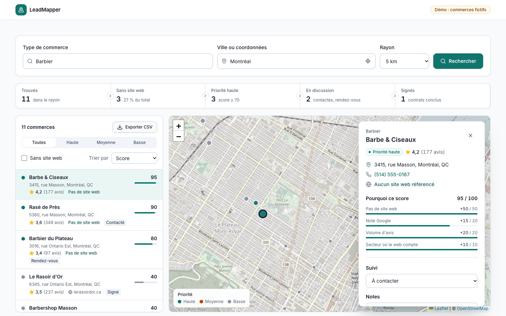
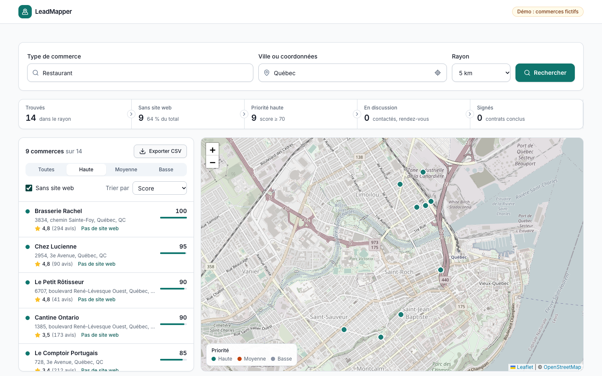
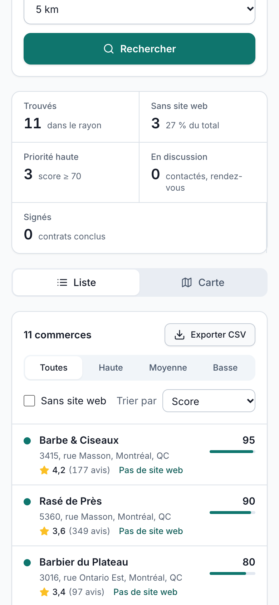
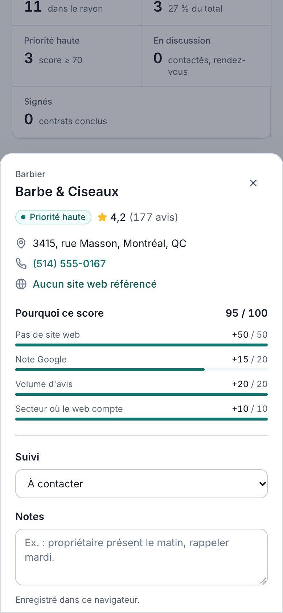

# LeadMapper

Outil de prospection pour designers et agences web : il repère sur Google Maps les commerces d'un quartier qui n'ont pas de site, les note sur 100 et garde le suivi des prises de contact.



## Le problème

Trouver des clients pour un site vitrine, c'est souvent éplucher Google Maps fiche par fiche pour voir qui n'a pas de site. LeadMapper fait ce tri en une recherche et classe les résultats pour qu'on appelle d'abord les commerces qui ont le plus besoin d'un site et les moyens de le payer.

## Ce que fait l'application

- **Recherche par secteur et ville** (ou position GPS), avec un rayon de 1 à 20 km.
- **Score de potentiel sur 100**, détaillé dans chaque fiche :
  - pas de site web : +50
  - note Google : jusqu'à +20
  - volume d'avis, signe d'un commerce établi : jusqu'à +20
  - secteur où le web compte (restauration, coiffure, santé…) : +10
- **Carte et liste synchronisées** : cliquer un commerce dans l'une le met en avant dans l'autre. Couleur des marqueurs selon la priorité.
- **Suivi commercial** : statut (à contacter, contacté, rendez-vous, signé, écarté) et notes par commerce, conservés dans le navigateur.
- **Filtres et tri** par priorité, présence d'un site, note, nombre d'avis.
- **Export CSV** compatible Excel (accents compris).
- **Mode démo** sans clé : des commerces fictifs à Montréal, Québec, Laval, Sherbrooke, etc. Le tirage est déterministe, la même recherche donne toujours les mêmes résultats.

| Filtres sur Québec | Liste mobile | Fiche mobile |
| --- | --- | --- |
|  |  |  |

## Stack

- **React 18 + TypeScript + Vite**, Tailwind CSS, composants Radix (shadcn/ui)
- **Leaflet / react-leaflet** sur fond OpenStreetMap
- **Express** : petite API qui appelle Google Places côté serveur (Text Search puis Place Details)
- Déploiement Vercel (front statique + fonction Node)

### Choix techniques

- **La clé Google ne quitte pas le serveur.** Le front appelle `/api/search`, qui valide les paramètres (texte borné, rayon dans une liste fermée) et interroge Google. Il n'existe pas de proxy générique vers une URL arbitraire.
- **Le score est calculé côté client** à partir des données brutes : une seule fonction (`src/lib/scoring.ts`) sert à la liste, à la carte et à l'explication affichée dans la fiche.
- **Pas d'email inventé.** Google Places ne fournit pas d'adresse email ; l'application n'en devine pas.
- **Accessibilité** : navigation complète au clavier depuis la liste, focus visible, contrastes AA, libellés sur tous les champs, états de chargement annoncés aux lecteurs d'écran.

## Lancer en local

Node 22 ou plus récent.

```bash
npm install
npm run dev
```

L'application s'ouvre sur http://localhost:5173 en mode démo, sans aucune configuration.

### Avec de vraies données Google Places

1. Créez une clé avec l'API Places activée dans Google Cloud.
2. Copiez `.env.example` en `.env` et renseignez `GOOGLE_MAPS_API_KEY`.
3. Lancez le front et l'API ensemble :

```bash
npm run dev:full
```

Le front passe alors en mode `google` et l'API écoute sur http://localhost:3001 (`/api/health` indique si la clé est détectée).

### Déploiement (Vercel)

Variables à définir dans le projet Vercel :

| Variable | Valeur |
| --- | --- |
| `GOOGLE_MAPS_API_KEY` | clé Google Places (secrète, lue par la fonction serveur) |
| `VITE_DATA_SOURCE` | `google` (sinon le site public tourne en mode démo) |

Restreignez la clé à l'API Places et fixez un quota journalier dans Google Cloud : `/api/search` est public.

### Scripts

| Commande | Rôle |
| --- | --- |
| `npm run dev` | Front seul, mode démo |
| `npm run dev:full` | Front + API Google Places |
| `npm run build` | Vérification TypeScript puis build de production |
| `npm run lint` | ESLint |
| `npm run typecheck` | TypeScript seul |

## Structure

```
src/
  components/      interface (recherche, liste, carte, fiche, états vides et erreurs)
  hooks/           useLeadSearch : recherche, annulation, suivi
  lib/             score, suivi (localStorage), export CSV
  services/        source de données : démo ou API
  server/proxy.js  API Express /api/search
```

## Limites connues

- Avec Google Places, le rayon ne s'applique que si l'on cherche par position GPS : l'API ignore le rayon pour une recherche par nom de ville.
- La limite de débit de l'API est gardée en mémoire : sur Vercel elle vaut par instance. Fixez aussi un quota dans Google Cloud.

## Pistes

- Synchroniser le suivi entre appareils (base de données et comptes) au lieu du stockage navigateur.
- Repérer aussi les sites existants vieillissants (pas de HTTPS, pas responsive) pour les offres de refonte.
- Rappels de relance à date.
